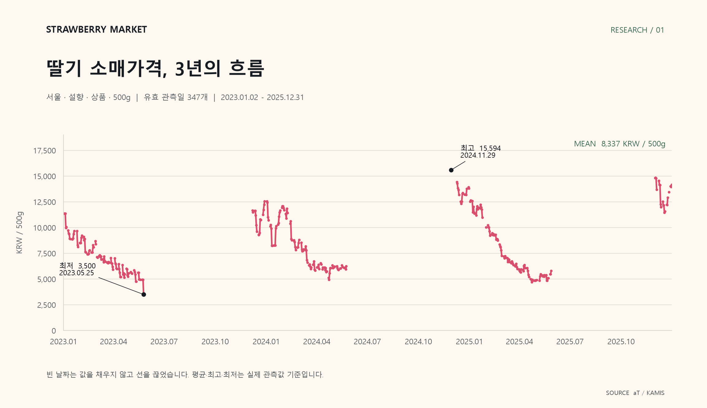

# STRAWBERRY MARKET

서울 딸기 소매가격의 흐름을 실제 KAMIS 자료로 분석하는 Python 프로젝트입니다.
품종·등급·단위를 고정하고, 저장된 원본 응답에서 정제 데이터와 그래프를 재생성합니다.



## 현재 확인된 결과

| 항목 | 결과 |
|---|---|
| 수집 조건 | 서울 · 딸기 · 설향 · 상품 · 500g · KAMIS 제공 평균 |
| 요청 기간 | 2023-01-01 ~ 2025-12-31 |
| 실제 관측 기간 | 2023-01-02 ~ 2025-12-31 |
| 원본 / 정제 행 수 / 유효 고유 날짜 수 | 347 / 347 / 347 |
| 결측 가격 / 0원 이하 / 중복 날짜 | 0 / 0 / 0 |
| 월별 조회 | 36개월 전체 조회, 관측 있는 달 19개 / 없는 달 17개 |
| 달력일별 상태 | 1,096일 중 가격 관측 347일 / 응답 미등장 749일 |
| 시각화 | 기본 3개 + 예측 1개 |
| 직전 가격 예측의 검증 MAE | 461.95원/500g, 마지막 20개 관측값 |

결과와 해석은 [REPORT.md](REPORT.md), 출처·수집 조건은 [data/SOURCE.md](data/SOURCE.md)에 있습니다.

최종 제출 자료: [발표자료](output/submission/strawberry_analysis_presentation_v8.pptx), [보고서](output/submission/strawberry_analysis_report.docx).
최신 사용자 요청에 따라 분석 기간을 2023~2025년으로 교체했습니다. 기존 114개 분석을 별도 보관하지 않습니다.
기존 계획서·요구사항의 이전 후보 기간은 문서 보존 지시에 따라 그대로 두며, 실제 수집은 최신 요청을 따릅니다.

로컬 분석을 구현했습니다. GitHub 업로드·공개 링크 확인과 사용자의 독립적인 결론 작성은 남아 있습니다.
PART 02 게임은 아직 구현하지 않았습니다.

## 실행 환경과 설치

검증 환경은 Windows / Python **3.14.7**입니다. 모든 의존성은 프로젝트 **`.venv`**에 설치합니다.
고정된 NumPy 버전의 요구 조건 때문에 현재 의존성 묶음은 Python **3.12 이상**이 필요합니다.
다른 Python 버전·운영체제에서의 실제 실행은 확인 안 됨입니다. 새 환경에서는 Python 3.14 사용을 권장합니다.

다음 명령은 **이 README가 있는 프로젝트 폴더**에서 실행합니다. 상위 Git 저장소에 가상환경을 만들지 않습니다.

Windows PowerShell:

```powershell
python -m venv .venv
.\.venv\Scripts\python.exe -m pip install -r requirements.txt
.\.venv\Scripts\python.exe -X utf8 analysis.py
.\.venv\Scripts\python.exe -X utf8 -m unittest discover -s tests -v
```

이미 `.venv`가 있다면 첫 명령은 생략합니다. 활성화 스크립트나 PowerShell 실행 정책 변경은 필요 없습니다.
PDF 검토 도구가 필요할 때만 `requirements-dev.txt`를 설치합니다. 분석·테스트에는 필요하지 않습니다.

macOS / Linux용 대응 명령(이 환경에서의 실행은 확인 안 됨):

```bash
python3 -m venv .venv
.venv/bin/python -m pip install -r requirements.txt
.venv/bin/python -X utf8 analysis.py
.venv/bin/python -X utf8 -m unittest discover -s tests -v
```

설치에는 인터넷이 필요합니다. 저장된 `data/source/`와 `source_manifest.json`이 있으면 분석·테스트는 네트워크 없이 실행됩니다.
한글 폰트는 맑은 고딕, AppleGothic, Noto Sans CJK KR, 나눔고딕 순서로 확인합니다.
없으면 글자가 깨지지 않도록 그래프에 영문 레이블을 사용합니다.

## 데이터 수집과 재현

[공식 농산물 소매가격 조회](https://www.kamis.or.kr/customer/price/agricultureRetail/period.do)의
공개 차트 응답을 이용합니다. 현재 경로에는 API 키·로그인이 필요하지 않았습니다.
외부 서비스의 응답 구조나 접근 조건이 바뀌면 수집이 실패할 수 있습니다.

```powershell
# 저장된 응답이 없으면 월별 수집, 있으면 해시를 검증하고 재사용
.\.venv\Scripts\python.exe -X utf8 collect_data.py

# 외부 요청 없이 원본 해시와 조회 조건을 확인하고 raw CSV 재생성
.\.venv\Scripts\python.exe -X utf8 collect_data.py --offline

# 원본 검증 → 정제 → 분석 → PNG 4개 생성
.\.venv\Scripts\python.exe -X utf8 analysis.py
```

월별 원본 JSON과 조회 조건을 담은 HTML을 보존합니다. 요청 시간·URL·매개변수·SHA-256은
`data/source_manifest.json`에 기록합니다. 기존 원본은 자동 갱신하거나 덮어쓰지 않습니다.
실제 데이터에 맞지 않는 조건, 해시 불일치, 충돌하는 날짜별 가격, 유효 관측일 100개 미만은 오류로 중단합니다.
수집 실패 시 이미 검증·저장된 월부터 재개할 수 있습니다. 저장된 기간·조건을 바꾸어 이어 붙일 수는 없습니다.

분석 스크립트는 아래의 **생성 결과만** 갱신합니다. `README.md`, `REPORT.md`, 기존 계획·요구사항·평가 PDF는 수정하지 않습니다.
보고서의 수치는 수집된 스냅샷 기준입니다. 분석 조건이나 원본을 바꾼 경우 보고서와 결과표를 다시 대조해야 합니다.

## 파일 구성

```text
M1-1/
├── .venv/                       # 로컬 의존성, Git 제외
├── collect_data.py              # 공식 공개 조회 수집·원본 검증
├── analysis.py                  # 정제·이동평균·변화율·예측·그래프
├── tests/test_analysis.py       # 오류·데이터 누수·독립 계산 검증
├── requirements.txt             # 실제 설치·실행한 의존성 고정
├── requirements-dev.txt         # PDF 검토용 선택 도구
├── data/
│   ├── SOURCE.md
│   ├── source/                  # 월별 원본 JSON·조회 HTML
│   ├── source_manifest.json
│   ├── strawberry_raw.csv
│   ├── strawberry_clean.csv
│   ├── analysis_results.csv     # 이동평균·변화율·관측 간격·후보 표시
│   ├── monthly_collection.csv   # 관측이 없는 달도 포함한 36개월 수집 기록
│   ├── annual_summary.csv
│   ├── monthly_summary.csv
│   ├── baseline_predictions.csv
│   ├── calendar_coverage.csv
│   ├── quality_report.json
│   └── analysis_summary.json
├── images/                      # 기본 PNG 3개 + 예측 PNG 1개
├── output/submission/           # 최종 발표자료와 Word 보고서
├── REPORT.md
├── README.md
├── PROJECT_PLAN.md              # 기존 문서 보존
├── REQUIREMENTS.md              # 기존 문서 보존
└── m1-1 평가항목.pdf             # 기존 문서 보존
```

`strawberry_raw.csv`는 공식 차트의 **평균 계열을 날짜별로 펼친 추출 결과**입니다.
원본의 세 계열(평균·전통시장·유통업체)은 `source/*.json`에 그대로 보존합니다.
서로 다른 시장의 가격을 새로 평균하거나 데이터 행 수에 합산하지 않습니다.

## 검증 및 제출 상태

- 자동 검증: 잘못된 날짜·단위·중복·결측·이상치 후보·7관측일 계산·예측 누수·원본 독립 계산과 36개월·윤년·빈 달·장기 공백을 검사합니다.
- 실행 결과: 자동 검증 **26개 통과**. 별도의 `.venv`에서도 분석·테스트가 통과했고, CSV·JSON·PNG 생성 결과 **14개가 바이트 단위로 일치**했습니다.
- 의존성: `.venv` 내 `python -m pip check`로 충돌 여부를 확인합니다.
- 수치 근거: 대표 날짜 3개에서 원본 가격과 `Decimal` 독립 계산을 대조합니다.
- 원본 보존: 기존 문서 3개의 SHA-256을 작업 전후 대조합니다.
- 제출 전 남은 항목: 사용자의 AI 없는 결론·구두 설명, 수집 경로의 재배포 이용 조건 확인, GitHub 공개 링크·이미지 표시 확인입니다.

`.gitignore`는 `.venv`, 임시 파일, 캐시, 환경변수 파일을 제외합니다. 커밋·푸시는 아직 수행하지 않았습니다.
데이터 출처는 한국농수산식품유통공사(aT) KAMIS이며, 서비스의 공식 결과를 분석한 개인 학습 프로젝트입니다.

## 3년 데이터의 결측과 공백

원본 가격 결측은 0건입니다. 응답에 날짜 자체가 없는 749일은 별도 상태로 기록하고 0원·보간값을 넣지 않습니다.
월별 통계는 36개월을 모두 표시하며 관측이 없는 17개월의 가격 통계는 빈 값입니다.
절댓값 20% 초과 후보 6건은 자동 삭제하지 않습니다. 그중 3건은 187~196일 간격의 비교입니다.
30일 초과 관측 공백을 `long_gap`으로 표시하며, 7관측일 계산에 이전 시즌 값이 포함될 수 있다는 한계를 보고서에 명시했습니다.
KAMIS에서 참고한 조회 조건·단위 표시와 평균·최고·최저 요약, 연도별 월평균 비교를 제공합니다.
