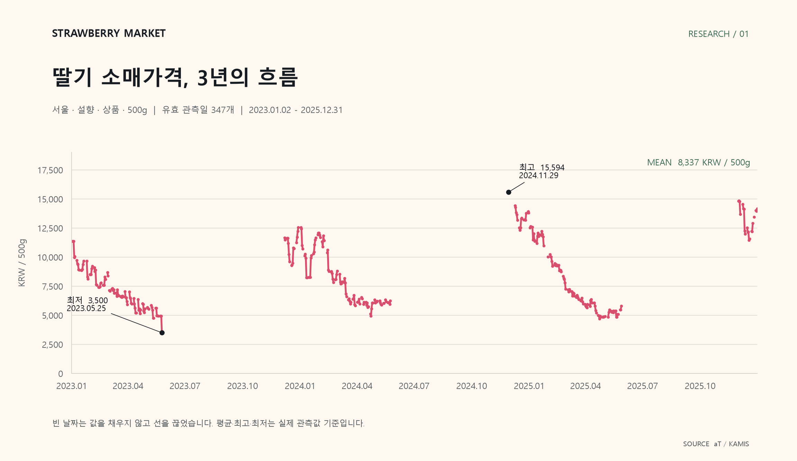
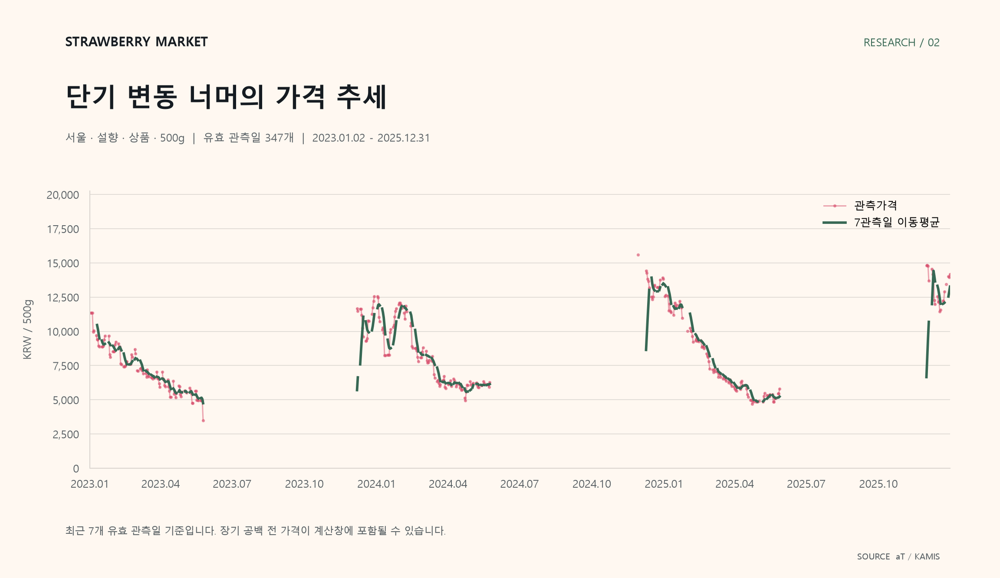
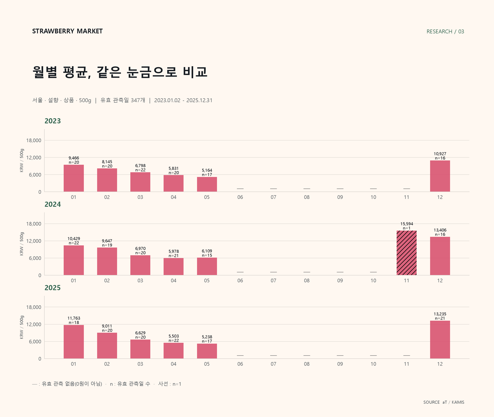
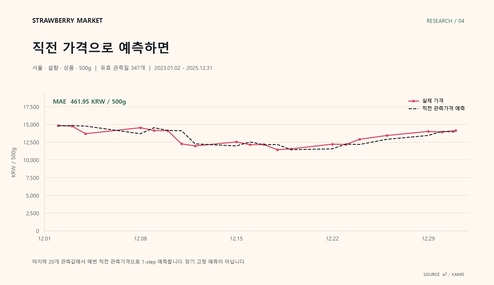

# 2023년부터 2025년까지 서울 딸기 소매가격 분석

## 1 분석 목적과 핵심 결과

KAMIS의 서울·설향·상품·500g 소매가격을 같은 조건으로 비교했습니다. 세 연도 모두 1월보다 5월 평균이 낮았습니다. 가격만으로 출하량·날씨 등 변동 원인을 확정하지 않았습니다.

| 항목 | 확인 결과 |
|---|---|
| 요청 기간 | 2023-01-01~2025-12-31, 한 달씩 36개 구간 조회 |
| 유효 관측 | 347개 날짜, 실제 범위 2023-01-02~2025-12-31 |
| 고정 조건 | 서울 / 딸기 / 설향 / 상품 / 500g / KAMIS 제공 평균 |
| 연도별 관측일 | 2023년 115개, 2024년 114개, 2025년 118개 |
| 평균과 범위 | 평균 8,337원, 최저 3,500원, 최고 15,594원 / 500g |

## 2 분석 질문

① 전체 가격 흐름과 평균·최고·최저는 어떻습니까?
② 큰 가격 변화는 언제 발생했고 관측 간격은 얼마입니까?
③ 같은 월의 가격 수준과 표본 수는 연도별로 어떻게 다릅니까?

## 3 KAMIS 조회와 재현 방법

공식 사이트에서 소매가격의 기간별 일간 조회를 선택하고, 지역 서울·품목 딸기·품종 설향·등급 상품·단위 500g을 고정했습니다. 기간만 월별로 바꾸어 조회했습니다. 원본의 평균 계열만 분석하며 다른 시장 계열을 날짜 수에 합산하지 않았습니다.

공식 원문: https://www.kamis.or.kr/customer/price/agricultureRetail/period.do

확인 예시: 2025년 12월을 조회하면 12월 1일 14,814원, 2일 14,838원, 3일 14,775원이 반환됩니다. 발표자료 2쪽의 원문 링크에서 같은 조건을 확인할 수 있습니다.

월별 원본 JSON·조회 HTML과 요청 조건·수집 시각·SHA-256을 보존했습니다. 분석은 원본 검증, 정제, 기법 계산, 시각화 순서로 실행합니다. 수집일은 2026-11-18이며 예시 가격은 2026-11-20에 재대조했습니다.

### 실행 방법

프로젝트 폴더에서 .venv\Scripts\python.exe -X utf8 analysis.py를 실행합니다. 저장된 원본이 있으면 네트워크 없이 재현됩니다.

## 4 정제 기준과 관측 공백

| 검사 항목 | 처리 전 | 처리 후와 이유 |
|---|---|---|
| 원본 / 유효 고유 날짜 | 347 / 347 | 모든 행의 조건과 날짜를 확인해 347행 유지 |
| 가격 결측·비수치·무한대 | 0건 | 유효 가격만 사용하며 결측은 별도 집계 |
| 0원 이하 / 중복 날짜 | 0 / 0건 | 가격 오류·중복 검사, 이번 제거 0건 |
| 요청 달력일 / 응답 미등장 | 1,096 / 749일 | 가격을 0원·보간·앞값으로 채우지 않음 |
| 20% 초과 변동 후보 | 6건 | 자동 삭제하지 않고 원본과 관측 간격 검토 |

가격이 비어 있는 행과 날짜 자체가 응답에 없는 경우를 구분했습니다. 관측이 없는 달은 17개이며, 그 이유가 휴일·비조사·비출하 중 무엇인지는 확인 안 됨입니다. 긴 공백을 보간하면 실제로 관측하지 않은 가격을 만들 수 있어 비워 두었습니다.

20%는 공식 오류 기준이 아닌 임시 선별선입니다. 30일 이하 간격의 343개 비교에서 절대 변화율 중앙값은 2.34%, 95백분위는 11.99%였습니다. 후보 6건 중 3건은 187~196일 간격의 비교입니다.

## 5 일별 가격 흐름



최저는 2023-05-25의 3,500원, 최고는 2024-11-29의 15,594원입니다. 그래프의 흰 구간은 응답에 가격이 없는 기간입니다. 전체 평균 8,337원은 실제 관측가격의 단순평균입니다.

## 6 이동평균과 변화율

7관측일 이동평균은 현재를 포함한 최근 7개 유효 관측가격의 평균입니다. 단기 요동을 완화해 흐름을 봅니다. 변화율은 (현재 가격 ÷ 직전 관측가격 − 1) × 100으로, 상대적인 변동을 비교합니다.



| 날짜 | 실제 가격 | 7관측일 평균 | 변화율 |
|---|---|---|---|
| 2023-01-10 | 9,429원 | 10,462.14원 | -2.9339% |
| 2024-03-27 | 6,728원 | 6,334.29원 | +4.4072% |
| 2025-12-31 | 14,161원 | 13,269.00원 | +1.5927% |

2023-01-10의 평균 10,462.14원은 2023-05-25에 4,747.71원으로 낮아졌습니다. 이 구간을 하락 추세의 예로 설명할 수 있습니다. 3년 전체가 계속 하락한 것은 아닙니다.

주의: 현재 계산은 장기 공백도 가로지릅니다. 2023-12-07 평균 5,704원에는 이전 5월 가격 6개가 포함됩니다. 또 3,500원에서 11,661원으로의 +233.17%는 196일 간격이므로 하루 급등률로 읽으면 안 됩니다.

## 7 월별 비교와 인사이트

월별 평균은 해당 월의 유효 가격을 같은 가중치로 평균한 값입니다. 연도별로 같은 월을 비교하며, 관측이 없는 달과 표본이 하나인 2024년 11월을 구분했습니다.



인사이트 1  월별 가격 차이

관찰: 1월 대비 5월 평균은 2023년 45.45%, 2024년 41.42%, 2025년 55.47% 낮았습니다. 가설: 공급·수요와 관련될 수 있으나 원인은 확인 안 됨입니다. 행동: 출하량·기상과 같은 월의 추가 연도를 비교합니다.

인사이트 2  변동률에는 관측 간격이 필요합니다

관찰: +233.17%는 196일 간격이고, 2023-05-24→05-25의 −29.29%는 1일 간격입니다. 가설: 공백과 단기 변동을 구분해야 합니다. 행동: 원천 시장별 기록을 대조하고 급변 값을 자동 삭제하지 않습니다.

인사이트 3  평균에는 표본 구성이 반영됩니다

관찰: 연평균은 2023년 7,660.79원, 2024년 8,766.54원, 2025년 8,581.03원입니다. 가설: 관측 월·날짜 구성이 영향을 줄 수 있습니다. 행동: 연평균과 함께 같은 월·중앙값·관측 수를 비교합니다.

## 8 보너스 과제 직전 관측가격 예측과 한계

보너스 과제의 시계열 심화 옵션 B 간단 예측입니다. 다음 관측일에도 직전 가격이 유지된다고 가정하는 나이브 기준선으로, 별도 학습 없이 마지막 20개 관측값을 순서대로 검증했습니다. 앞의 327개는 과거 구간이며, 검증 기간은 2025-12-02~12-31입니다.



| 대상일 | 사용한 직전 가격 | 예측 | 실제 | 절대 오차 |
|---|---|---|---|---|
| 12월 2일 | 12월 1일 14,814원 | 14,814원 | 14,838원 | 24원 |
| 12월 3일 | 12월 2일 14,838원 | 14,838원 | 14,775원 | 63원 |

실제값을 관측한 뒤 다음 예측을 갱신합니다. 현재·미래 실제값을 그 시점 예측에 쓰지 않습니다. 오차 절댓값 20개의 평균은 461.95원입니다. 이 그래프는 과거 검증이며 2026년 가격 전망은 포함하지 않습니다.

## 9 반례와 결론의 범위

전체 첫·마지막 가격은 11,357원에서 14,161원으로 +24.69%였지만, 마지막 20관측일은 14,838원에서 14,161원으로 −4.56%였습니다. 비교 기간을 바꾸면 방향이 달라집니다. 시작과 끝의 월도 달라 일반적인 물가 상승으로 단정하지 않습니다.

단일 지역·품종·등급, 749일의 응답 미등장, 월별 표본 불균형과 외부 변수 미포함이 한계입니다. KAMIS 평균의 원천 점포 구성과 가중 방식도 별도 확인 안 됨입니다. 후속으로 출하량·시장별 조사 표본·기상 자료를 제안하며, 이 외부 자료는 아직 수집하지 않았습니다.

## 10 AI 활용과 검증

| 사용 작업과 이유 | 검증 근거 |
|---|---|
| 수집·정제 코드와 반복 집계 | 원본 36개 JSON 해시·조건 확인, 347개 날짜·단위·결측·중복 대조 |
| 그래프·예측과 결과 설명 | PNG 4개 확인, 미래값 참조 방지 검사, 사실과 원인 가설 구분 |
| 계산 검증 | 2023-01-10·2024-03-27·2025-12-31을 원본 JSON과 Decimal 독립 계산으로 대조 |

검산 예시: 2025-12-31의 7개 가격 합계 92,883원을 7로 나누면 13,269원입니다. 변화율은 (14,161 ÷ 13,939 − 1) × 100 = +1.592654%입니다. 원본과 계산 결과가 일치했습니다.

검증 방법을 설명하는 항목과 AI 없이 핵심 결론을 본인 말로 설명하는 항목은 구별합니다. 발표자료에는 짧은 설명과 발표 메모를 제공하며, 사용자의 독립적인 이해·설명 완료 여부는 확인 안 됨입니다.

## 11 평가항목 17개 대응표

| 문항 | 요구 내용 | 근거와 준비 상태 |
|---|---|---|
| 1-1 | 100개 이상 | 데이터 개요와 정제 결과: 347개 고유 관측일 |
| 1-2 | 분석 질문 3개 | 1쪽 분석 질문 |
| 1-3 | 기법 2개 이상 결과 | 3쪽 이동평균·변화율 |
| 1-4 | 시각화 2개 | 그림 1·2 |
| 1-5 | 시각화 3개 | 그림 3 포함 |
| 1-6 | 근거 있는 인사이트 3개 | 4쪽 관찰·가설·행동 |
| 1-7 | GitHub 제출 | 코드·출처·실행 안내 준비, 게시 확인 필요 |
| 2-1 | 처리 흐름 설명 | 1~3쪽 수집·정제·분석·시각화 |
| 2-2 | 결측·이상치 기준의 이유 | 2쪽 0원 보정·자동 삭제를 피한 이유 |
| 2-3 | 집계 단위와 이유 | 3~4쪽 관측일·연월별 비교 |
| 3-1 | 기법 목적 설명 | 3쪽 단기 요동·상대적 변동 비교 |
| 3-2 | 추세·계절성·노이즈 설명 | 3쪽 2023년 상반기 하락 추세 |
| 3-3 | AI 코드·해석 검증 | 6쪽 원본·독립 계산·검사 |
| 4-1 | Fact Why Action | 4쪽 대표 인사이트 |
| 4-2 | 반례 | 5쪽 +24.69%와 −4.56% 비교 |
| 4-3 | 한계·추가 데이터 | 5쪽 공백·표본·출하량 등 |
| 4-4 | 본인 말로 결론 설명 | 발표 메모 활용 후 사용자 직접 확인 필요 |

자료 기준: KAMIS 원본 수집 2026-11-18, 발표 예시 재대조 2026-11-20. 웹 차트 응답의 재배포 허용 범위는 확인 안 됨이며, 외부 배포 전 조건을 확인합니다. 데이터 대신 수집 코드·획득 방법으로 제출할 수도 있습니다.

## 직접 설명할 때의 핵심 문장

- 출처: KAMIS에서 서울·설향·상품·500g을 고정하고 2023~2025년을 한 달씩 조회했습니다.
- 결측 처리: 가격 결측은 0건이고 날짜가 없는 749일은 관측 공백으로 분리했습니다. 가격을 만들지 않기 위해 0원이나 보간값을 넣지 않았습니다.
- 이동평균: 최근 7개 유효 관측가격의 평균으로 단기 흔들림을 줄였습니다. 7달력일과 다르며 장기 공백 전 가격이 포함될 수 있습니다.
- 변화율: 직전 관측가격과 비교한 비율입니다. 196일 간격의 +233.17%를 하루 급등으로 읽지 않습니다.
- 보너스 과제 간단 예측: 직전 관측가격을 다음 관측일의 예상값으로 사용했습니다. 과거 20건의 평균 절대 오차는 461.95원입니다.
- 결론: 세 연도 모두 1월보다 5월 평균이 낮았습니다. 가격만으로 변동 원인을 확정하지 않았습니다.

설명 문장은 발표 준비용 초안입니다. 실제 이해와 본인 말로 설명하는지 여부는 사용자가 확인해야 합니다.

## 실행과 근거 파일

프로젝트 루트에서 다음 명령을 실행합니다.

```powershell
.\.venv\Scripts\python.exe -X utf8 analysis.py
.\.venv\Scripts\python.exe -X utf8 -m unittest discover -s tests -v
```

원본과 품질: [월별 수집](data/monthly_collection.csv), [품질 점검](data/quality_report.json), [원본 명세](data/source_manifest.json).
계산과 예측: [분석 결과](data/analysis_results.csv), [월별 통계](data/monthly_summary.csv), [예측 검증](data/baseline_predictions.csv).
출처와 이용 조건: [수집 기록](data/SOURCE.md), 실행 환경: [README](README.md).
