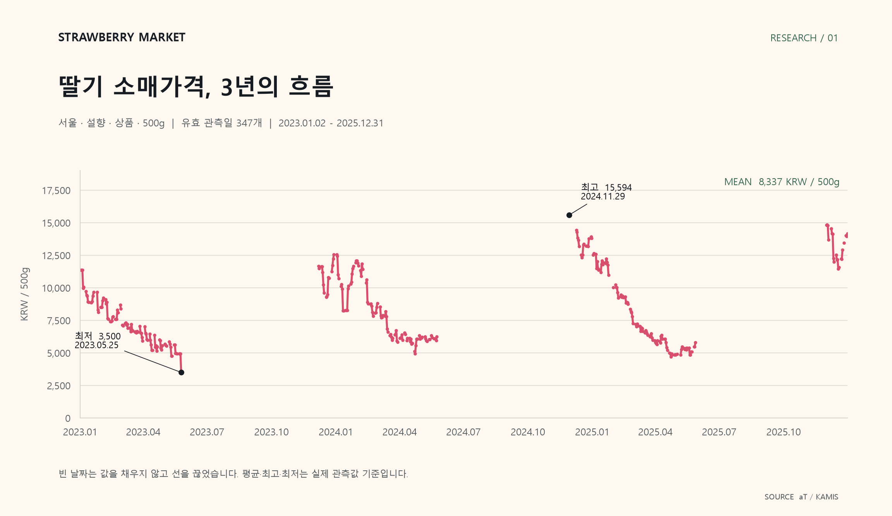

# 딸기 소매가격 시계열 분석 — 과제 요구사항 명세서

> **문서 목적:** 시계열 데이터 분석 과제의 요구사항을 **딸기 가격 데이터**에 맞추어 정리한 실행 계획입니다. **첨부된 「m1-1 평가항목.pdf」 9~10쪽의 평가문항 1~4(세부 질문 17개)를 프로젝트 필수 검증 기준으로 반영**합니다.  
> **상태:** 평가문항 반영 개정본 / 구현 전 요구사항 분석(실제 데이터 수집·분석 결과가 아님)  
> **선택 데이터:** 한국농수산식품유통공사(aT) / KAMIS의 딸기 일별 **소매가격**  
> **선택 보너스:** (B) 간단 예측(베이스라인 방식)  
> **개발 순서:** **PART 01 데이터 분석 완성 및 검증 → PART 02 거래 시뮬레이션(선택 확장)**

## 1. 과제 목표

한국농수산식품유통공사의 공공데이터에서 딸기의 일별 소매가격을 확보해 시계열 패턴을 분석합니다. 가격 추세·변화·월별 차이를 시각화하고, **관찰(수치/근거)**과 **해석(가설)**을 구분하여 인사이트를 도출한 뒤 `REPORT.md`로 정리합니다.

- **필수 결과물:** Markdown 분석 리포트, Python 분석 코드, 시각화 이미지, 데이터(또는 수집 스크립트), GitHub 저장소
- **추가 수행할 보너스:** 과거 가격을 기준으로 한 간단 예측 및 결과 그래프 1개 이상
- **PART 01 — 데이터 분석(우선):** 이 문서의 필수 요구사항 및 선택 보너스 (B)를 먼저 완성합니다.
- **PART 02 — 거래 시뮬레이션(나중에, 선택):** PART 01 결과물의 실행 및 제출 검증이 끝난 이후에만 시작합니다. **게임 제작은 필수 과제 또는 선택 보너스 (B)의 완료 조건이 아니며, 게임 때문에 PART 01을 미완성 상태로 두지 않습니다.**
- **평가 최우선 원칙:** 원래 과제 설명에서 *권장*한 그래프 3개도 **이번 프로젝트에서는 필수**로 수행합니다. 평가표의 '설명할 수 있는가?' 질문은 단순한 문구 기재로 끝내지 않고, **근거 수치·처리 이유·검증 기록을 제시하고 직접 설명할 수 있어야 완료**로 판정합니다.
- **평가 기준 출처:** 사용자 제공 `m1-1 평가항목.pdf`의 **「5. 평가문항」(9~10쪽)**. 평가 항목 5는 보너스 크레딧이며, 이 프로젝트에서는 이미 선택한 **간단 예측(B)**을 수행합니다.

## 2. 분석 주제 및 데이터 선정

### 2.1 분석 주제

**「2024~2025년 딸기 일별 소매가격 변화와 가격 변동 패턴 분석」**

- 선정 이유: 딸기의 가격 변화와 시기별 차이를 관찰하고, 데이터를 게임 속 거래·판매가격 시스템에도 활용하기 위해서입니다.
- 분석 단위: **날짜별 딸기 소매가격 1개 시계열**
- 예정 기간: **2024-11-01 ~ 2025-05-31** (딸기 출하 시기를 고려한 후보 기간)
- 최소 데이터: **유효한 날짜별 관측값 100개 이상**
- **주의:** 예정 기간에 실제로 100개 이상의 유효 관측값이 있는지는 데이터를 수집한 다음 검증해야 합니다. 자료가 부족하면 기간 또는 조사 조건을 조정하고 그 이유를 기록합니다.

### 2.2 공공데이터 출처

| 구분 | 내용 |
|---|---|
| 제공기관 | 한국농수산식품유통공사(aT) |
| 데이터 서비스 | KAMIS 농산물유통정보 / 공공데이터포털 |
| 선택 품목 | 딸기 |
| 가격 종류 | **소매가격** (도매가격과 혼합 금지) |
| 수집 방식 | 공공데이터포털 일별 도·소매 가격 API 또는 KAMIS 기간별 소매가격 조회/API |
| 자료 형식 | API: JSON·XML / 조회 화면의 제공 기능에 따라 파일 저장 가능 |
| 비용·이용 조건 | 공공데이터포털의 해당 API는 **무료**, **이용허락범위 제한 없음**으로 안내됨. 실제 사용 시 최신 이용 조건 재확인 |
| 인증 | 공공데이터포털 API 이용 시 서비스키/활용신청 필요 가능 |

**공식 자료:**

1. [KAMIS 기간별 소매가격 조회](https://www.kamis.or.kr/customer/price/retail/period.do)
2. [KAMIS 기간설정 가능 일별 품목별 소매가격 API 안내](https://www.kamis.or.kr/customer/reference/openapi_list.do?action=detail&boardno=17)
3. [공공데이터포털 — 한국농수산식품유통공사 일별 도·소매 가격정보 조회](https://www.data.go.kr/data/15156057/openapi.do)

> **수집 시 반드시 확정할 항목:** 딸기 품목·품종코드, 지역(또는 전국 평균), 등급, 가격 단위(원/100g·원/kg 등 실제 응답 기준), 시장 또는 집계 기준. 분석 구간에서 이 조건을 일관되게 유지합니다. 여러 지역·등급·시장 데이터의 행 수를 합쳐 '100개 날짜'라고 계산하면 안 됩니다.

### 2.3 사용할 데이터 컬럼(정제 후)

| 컬럼(예시) | 설명 | 필수 여부 |
|---|---|---|
| `date` | 조사일자(`YYYY-MM-DD`) | 필수 |
| `price` | 조사일 소매가격(원, 단위 일치) | 필수 |
| `item` | 품목명(딸기) | 권장 |
| `region` | 지역/집계 범위 | 권장 |
| `variety` | 품종 | 권장 |
| `grade` | 등급 | 권장 |
| `unit` | 가격 단위 | 권장 |

API 응답의 실제 컬럼 이름은 다를 수 있으며, 수집 과정에서 위와 같이 표준화합니다.

## 3. 분석 질문(3개 이상 필수)

1. **가격 추세:** 분석 기간 전체에서 딸기 소매가격은 어떤 상승·하락 흐름을 보이는가?
2. **급등락:** 일별 가격이 크게 오른 날과 떨어진 날은 언제이며, 변화 폭은 얼마나 되는가?
3. **월별 차이:** 월별 평균 가격은 어떻게 다르며, 높은 가격과 낮은 가격이 나타나는 시기는 언제인가?
4. **추가 해석:** 급격한 변화가 관찰된 시점을 출하량·기상·수요 등 외부 요인으로 설명할 가능성이 있는가? (실제 원인이라고 단정하지 않음)

## 4. 데이터 정제 및 시계열 분석(필수)

### 4.1 기본 정보 확인

- [ ] 데이터 총 행 수 및 **고유 조사일 수** 확인
- [ ] 분석 시작일·종료일 확인
- [ ] 데이터 컬럼명·자료형·단위 확인
- [ ] 날짜 변환 및 오름차순 정렬
- [ ] 날짜 중복 여부 및 동일 날짜 다중 관측의 원인 확인
- [ ] 결측치·비정상 값·비수치 표현 확인

### 4.2 결측치 처리 기준

- 조사가 없는 날짜와 **조사했지만 가격이 결측인 날짜**를 구분합니다.
- 가격의 빈칸, `-` 등 비수치 표현은 결측값(`NaN`)으로 변환합니다.
- 날짜별 가격이 없는 경우 **0원으로 채우지 않습니다.**
- 기본 분석에서는 유효한 가격이 있는 관측일을 사용하고, 빠진 날짜·건수·처리 방식은 리포트에 기록합니다. **그렇게 처리한 이유**(0원 보정의 왜곡 방지, 임의 보간의 추세 왜곡 우려 등)도 명시합니다.
- 이동평균은 기본적으로 **최근 7개 유효 관측값** 기준으로 계산하고, '7일 달력 기준'과 혼동되지 않게 표시합니다.
- 정제 전후 행 수·고유 날짜 수·결측 수와 제외된 행의 사유를 표로 남겨, 선택 기준과 결과를 재현할 수 있도록 합니다.

### 4.3 이상치 처리 기준

- `price <= 0`인 값이나 단위가 섞인 기록은 오류 여부를 먼저 확인합니다.
- 전일 관측 대비 변화율이 큰 값(예: 절댓값 20% 초과)은 **확인 대상 후보**로 표시하되, 자동 삭제하지 않습니다. **20%는 사전 점검을 위한 임시 기준이며 KAMIS 공식 이상치 판정 기준이 아닙니다.** 실제 데이터 분포와 사례를 확인해 최종 기준을 선택하고 그 이유를 적습니다.
- 공식 원자료와 대조하고, 오류로 확인된 경우에만 수정·제외합니다. 실제 급등락이라면 유지합니다.
- 결측·이상치가 없으면 **없다는 사실과 확인 기준**을 보고합니다.

### 4.4 적용할 분석 기법(최소 2개 필수)

| 기법 | 계산 또는 집계 내용 | 목적 |
|---|---|---|
| **이동평균** | 최근 7개 유효 관측일 가격의 평균 | 단기 가격 변동을 완화해 추세 확인 |
| **가격 변화율** | `(당일 관측가격 / 직전 유효 관측가격 - 1) × 100` | 가격 급등락 확인 |
| **월별 평균 가격** | 월별 유효 관측일 가격의 산술평균 | 월별 가격 수준 비교 |

> 직전 **관측일**이 실제 전날과 다를 수 있으므로, 변화율을 해석할 때 관측 간 날짜 간격을 함께 확인합니다. 한 번의 출하 시즌만 분석한다면 월별 차이를 **장기적으로 반복되는 계절성**이라고 단정하지 않습니다.

### 4.5 평가 대비: 분석 흐름·기법·패턴 설명(필수)

다음 내용은 **평가문항 2·3**에 맞춘 별도의 설명 의무입니다. 각 항목의 코딩 결과뿐 아니라 선택 이유도 `REPORT.md`에 기술합니다.

1. **처리 흐름:** 원본 데이터 **로딩 → 구조·단위 점검 → 결측/이상치 처리 → 날짜별 단일 시계열 확정 → 분석 기법 적용 → 그래프 생성 → 인사이트 해석** 순서와 각 단계의 입력/출력을 설명합니다.
2. **처리 기준의 이유:** 결측을 왜 0으로 채우지 않는지, 급등락을 왜 자동으로 지우지 않는지, 동일 날짜·지역·품종·등급의 중복을 어떻게 해결했는지를 **사유 및 전후 건수**와 함께 제시합니다.
3. **집계 단위의 이유:** 일별 그래프는 단기 가격 변화 파악을 위해, 월별 그래프는 가격 수준 비교를 위해 사용합니다. 7관측일 이동평균을 7달력일 평균으로 오인하지 않도록 구분합니다.
4. **분석 기법의 목적:** 이동평균은 단기 변동을 완화하여 흐름을 보려는 것, 변화율은 연속된 유효 관측값 사이의 상대적 가격 변화를 보려는 것임을 **실제 그래프 구간**을 들어 설명합니다.
5. **트렌드·계절성·노이즈:** 셋 중 **최소 1개**를 실제 그래프의 구간·수치와 연결해 설명합니다. 예를 들어 원자료의 단기 요동과 이동평균의 비교로 노이즈를 설명할 수 있습니다. **한 시즌의 월별 차이만으로 반복적 계절성을 확정하지 않습니다.**
6. **평가 대응 근거:** 적어도 하나의 대표 날짜/구간을 선정해 원본 가격, 정제값, 계산값, 그래프 표시가 서로 일치하는지 직접 대조합니다. 검증 결과를 `REPORT.md`의 방법 또는 AI 사용 로그에 남깁니다.

## 5. 시각화(이번 프로젝트 필수 3개 + 선택한 보너스 예측 1개)

원래 미션의 **최소 필수는 2개, 추가 1개는 권장**이지만, 사용자 요청에 따라 평가문항의 권장 항목까지 **이번 프로젝트에서는 기본 그래프 3개를 필수**로 판정합니다. 보너스 예측 그래프는 별도 1개를 추가합니다.

| 파일명 | 그래프 | 확인할 내용 | 구분 |
|---|---|---|---|
| `images/01_price_trend.png` | 일별 딸기 소매가격 추세 | 전체 가격 흐름과 급변 시점 | 필수 구성 |
| `images/02_moving_average.png` | 일별 가격 + 7관측일 이동평균 | 단기 변동과 추세 비교 | 필수 구성 |
| `images/03_monthly_average.png` | 월별 평균 가격 | 월별 차이 비교 | **프로젝트 필수(원 미션: 권장)** |
| `images/04_baseline_prediction.png` | 실제값 vs 단순 예측값 | 예측 보너스의 성능·한계 확인 | 보너스 |

- [ ] **기본 그래프 3개 모두 생성**(평가문항 1의 권장 1개 포함)
- [ ] 날짜 순서·축 레이블·가격 단위·제목 표시
- [ ] 각 이미지 파일을 저장하고 `REPORT.md`에 상대경로로 삽입
- [ ] **각 그래프**의 집계 단위(일별/월별/7개 관측일 등) 및 선택 이유를 리포트에 설명
- [ ] 각 그래프 아래에 관찰한 사실(수치/날짜)과 가능한 해석을 구분하여 작성
- [ ] 그래프의 날짜 정렬·누락 구간·축 범위가 잘못된 해석을 유발하지 않는지 확인
- [ ] 그래프 링크가 GitHub에서 정상 출력되는지 확인

Markdown 이미지 삽입 예시:

```md

```

## 6. 인사이트 도출(3개 이상 필수)

각 인사이트에는 **관찰(Fact) → 해석/가설(Why) → 행동/추가 분석(Action)**을 포함합니다.

| 인사이트 | 관찰에 사용할 근거 | 해석 시 주의사항 |
|---|---|---|
| ① 전체 가격 추세 | 시작·마지막 가격, 최저·최고 가격 및 해당 날짜 | 가격 변화의 원인을 데이터 없이 단정하지 않기 |
| ② 급등락 구간 | 변화율 상위·하위 날짜 및 실제 변동률 | 조사 공백, 단위 변경, 오류 여부 먼저 확인 |
| ③ 월별 가격 차이 | 월별 평균 가격, 최고·최저 월, 차이 금액 | 단일 시즌만으로 일반적인 계절성 확정 금지 |

**리포트 작성 템플릿(실제 결과로 채울 것):**

> - **관찰(Fact):** [날짜/기간] 가격이 [수치]원에서 [수치]원으로 변했고 변화율은 [수치]%였습니다.  
> - **해석(가설):** [가능한 요인]과 관련될 가능성이 있으나 가격 데이터만으로 인과관계를 확인할 수 없습니다.  
> - **행동(Action):** [추가 검증할 자료 또는 게임 내 가격 규칙 실험]을 진행할 수 있습니다.

**중요:** 위 표와 템플릿은 **작성 계획**입니다. 실제 인사이트 수치와 결론은 데이터를 분석한 뒤에만 기입합니다.

### 6.1 평가문항 4: 반례·한계·추가 데이터(필수)

- [ ] 인사이트 **3개 모두**에 최소 1개의 수치·구간·날짜 등 관찰 근거를 연결합니다.
- [ ] **인사이트 1개 이상**은 평가에서 말로 설명할 수 있도록 **관찰(Fact) → 원인 가설(Why) → 행동(Action)**의 연결 논리를 정리합니다.
- [ ] **분석 결과가 달라질 수 있는 반례를 최소 1개** 제시합니다. 예: 조사 기간을 다르게 잡으면 가격 추세가 바뀔 수 있음, 월별 평균 대신 중앙값을 쓰면 순위가 달라질 수 있음. 실제 해당 반례가 성립하는지는 가능하면 재계산해 확인하며, 검증하지 못했다면 가설로 표현합니다.
- [ ] **한계점**(단일 품목·단일 지역·관측일 공백·외부 요인 미포함 등)을 분석 내용에 맞춰 명시합니다.
- [ ] 다음 단계에서 **추가 수집/검증하면 좋은 데이터**를 구체적으로 하나 이상 제시합니다. 예: 같은 기간의 딸기 출하량, 재배지 기온, 타 지역 가격, 전년 동기 가격. **실제 확보하지 않은 자료는 확보했다고 적지 않습니다.**

## 7. 보너스 과제 — (B) 간단 예측 선택

### 7.1 구현 범위

- [ ] 시계열을 **시간 순서대로** 학습 구간과 검증 구간으로 분리(예: 마지막 20개 유효 관측값을 검증용으로 사용)
- [ ] **직전 관측가격을 다음 관측일의 예측값으로 쓰는 나이브(naive) 방식** 적용
- [ ] 검증 구간의 실제 가격과 예측값을 비교해 **MAE(평균절대오차)** 계산
- [ ] `images/04_baseline_prediction.png` 저장
- [ ] 단순 예측의 가정·한계(급등락에 취약, 외부 요인 미반영, 장기 예측 부적합) 작성

> 이 방법은 *다음 관측일 1-step 예측*을 검증하는 방식입니다. 과거 전체 가격을 단순 복사하거나 미래 실제값을 미리 사용하는 데이터 누수를 방지합니다. 정확도보다 **방법의 가정과 한계 설명**에 집중합니다.

## 8. 분석 리포트 `REPORT.md` 구성(필수)

다음 목차대로 작성합니다.

1. **분석 주제 및 선정 이유**
2. **분석 질문** — 3개 이상
3. **데이터 설명** — 제공기관, 출처, 기간, 실제 관측값 수, 컬럼·단위, 이용 조건
4. **데이터 정제 및 분석 방법** — 결측치·이상치 처리, 시계열 기법 2개 이상
5. **분석 결과 및 시각화** — **기본 이미지 3개 필수**(원 미션의 권장까지 포함), 각 집계 단위·선택 이유·관찰 근거
6. **인사이트** — 3개 이상, 각각 관찰(Fact)·원인 가설(Why)·행동(Action) 구분
7. **결론 및 한계점** — 의사결정에 주는 의미, 관측 공백·외부 변수 미반영, **반례 1개 이상 및 추가 검증 데이터 제안**
8. **AI 사용 로그** — 사용 작업·이유·검증 방법, **실제 검증 사례와 본인 말로 재구성한 핵심 결론**
9. **보너스: 간단 예측** — 구현 방법, 그래프, 오차, 가정·한계

> 위 목차의 **4. 데이터 정제 및 분석 방법**에는 로딩→정제→분석→시각화 순서, 처리 기준을 선택한 이유, 이동평균·변화율의 목적, 트렌드/계절성/노이즈 중 1개 이상을 실제 그래프와 연결한 설명이 반드시 포함되어야 합니다.

### 8.1 AI 사용 로그(반드시 포함)

| 항목 | 기록할 내용(예시; 실제 사용에 맞게 수정) |
|---|---|
| 사용 작업 | 전처리 코드 초안, 그래프 코드 작성, 리포트 문장 점검 |
| 사용 이유 | 반복 작업 시간 절감, 코드 작성 대안 확인 |
| 검증 방법 | 실제 Python 실행, 일부 날짜 원본 가격 대조, 그래프/계산 결과 수작업 확인 |

AI로 생성한 코드·해석은 검증하고, 최종 결론은 관측 수치에 근거해 직접 작성합니다.

**평가문항 3·4에 따른 필수 추가 기록:**

- **구체적 검증 사례:** AI가 제안한 이동평균/변화율 계산 결과에서 2~3개 날짜를 선택해 Python 계산 결과와 손계산 또는 독립 계산을 대조하고, 불일치 시 수정 기록을 남깁니다.
- **해석 검증:** AI가 제안한 원인 가설은 원자료만으로 확인 가능한 주장인지, 외부 자료가 필요한 주장인지 구별하고 확인되지 않은 인과관계는 단정하지 않습니다.
- **독립적 설명:** AI가 만든 문장을 그대로 암기하는 대신, 실제 가격 수치 한두 개를 근거로 핵심 결론을 **AI 없이 본인 말로 재구성**하여 `REPORT.md`에 짧게 작성하고 평가 때 설명할 수 있도록 합니다.

## 9. Python 코드·재현성·GitHub 제출

### 9.1 개발 환경

- Python **3.10 이상**
- `analysis.ipynb` **또는** `analysis.py`
- 의존성: `requirements.txt`에 실제 설치한 라이브러리와 버전 기재
- 수집에 인증키가 필요하면 **환경변수 등으로 관리**하고 GitHub에 공개하지 않습니다.
- 데이터 수집 방법·실행 순서·라이선스/출처를 `README.md`에 작성합니다.

### 9.2 폴더 구조

```text
strawberry-price-analysis/
├── data/
│   └── strawberry_retail_2024_2025.csv
├── images/
│   ├── 01_price_trend.png
│   ├── 02_moving_average.png
│   ├── 03_monthly_average.png
│   └── 04_baseline_prediction.png
├── analysis.ipynb          # 또는 analysis.py
├── REPORT.md
├── REQUIREMENTS.md
├── PROJECT_PLAN.md
├── README.md
└── requirements.txt
```

원본 데이터의 재배포가 적절하지 않거나 파일 업로드가 어려우면 **데이터 수집 스크립트와 획득 방법**을 대신 포함합니다. API 키나 개인정보는 업로드하지 않습니다.

### 9.3 GitHub 제출 조건

- [ ] 코드, 리포트, 이미지, 의존성 파일 포함
- [ ] 데이터 파일 또는 수집 방법 포함
- [ ] `README.md`에 실행 방법 작성
- [ ] `REPORT.md`의 이미지 상대경로 정상 동작 확인
- [ ] GitHub의 코드·리포트·실행 안내·데이터 출처를 **제3자가 따라 해볼 수 있는 수준**으로 제공(인증키 보안과 접근 제한을 고려한 대체 방법 포함)
- [ ] GitHub 저장소 링크 제출

> 과제는 **GitHub 저장소를 요구**하지만, **반드시 새 저장소를 만들라고 명시한 것은 아닙니다.** 기존 저장소 사용도 가능합니다.

## 10. 진행 순서

**아래 1~9번은 모두 PART 01입니다. PART 02 게임 구현은 아래 작업을 완료하고 검증한 뒤에만 시작합니다.**

1. KAMIS에서 딸기 소매가격 조회 조건(품종·등급·지역·단위) 확정
2. 예정 기간의 자료를 수집하고 **고유 날짜의 유효 관측값 100개 이상** 확인
3. 중복·결측·이상치 점검, 처리 결과 기록
4. 이동평균·변화율·월별 평균 계산
5. **평가 기준에 따라 필수로 정한 기본 그래프 3개** 제작(집계 단위·목적·예시 구간 설명 포함)
6. 실제 관측 수치로 인사이트 3개 작성, **반례 1개·추가 검증 데이터 1개 이상 제시**
7. 마지막 검증 구간을 이용한 **간단 예측**과 그래프 1개 제작
8. `REPORT.md`에 결론·한계·AI 사용 로그 포함, **트렌드/계절성/노이즈 설명 및 AI 검증·독립 결론 작성**
9. `README.md`, `requirements.txt` 작성 및 GitHub 업로드
10. **PART 01 검증:** 서로 다른 유효 관측일 100개 이상, **기본 그래프 3개**, 평가문항 1~4의 **17개 세부 질문** 전부, 보너스 예측, GitHub 파일·링크·재현성이 모두 충족되는지 확인
11. **(선택, 이후)** PART 02 거래 시뮬레이션 개발 시작. 게임은 분석된 CSV/JSON을 재사용하며, PART 01 결과물을 수정·훼손하지 않도록 별도 `game/` 폴더에 구현

## 11. 최종 요구사항 체크리스트

### 필수 — 데이터 및 분석

- [ ] 딸기 일별 소매가격 데이터 선정 및 출처·기간 명시
- [ ] **고유 날짜 기준 유효 관측값 100개 이상**
- [ ] 분석 질문 **3개 이상**
- [ ] 데이터 기본 정보와 결측치·이상치 확인
- [ ] 결측치·이상치 처리 기준과 결과 명시
- [ ] 시계열 분석 기법 **2개 이상** 적용
- [ ] 기본 시각화 **3개 이상(프로젝트 필수; 원 과제 기준 필수 2개+권장 1개)**
- [ ] 근거가 있는 인사이트 **3개 이상**
- [ ] **관찰과 해석** 구분
- [ ] 로딩 → 정제 → 분석 → 시각화 흐름 단계별 설명
- [ ] 결측치·이상치 **처리 기준 선택 이유** 및 처리 전후 수치 제시
- [ ] 일/월/관측일 이동평균의 **집계 단위와 선택 이유** 설명
- [ ] 이동평균·변화율의 **분석 목적**을 실제 구간과 연결
- [ ] 트렌드/계절성/노이즈 중 **최소 1개**를 그래프에서 구분해 설명
- [ ] 결과가 달라질 수 있는 **반례 최소 1개** 제시
- [ ] **한계점과 다음 단계 추가 수집/검증 데이터** 제안

### 필수 — 문서 및 제출

- [ ] `REPORT.md` — 주제, 질문, 데이터, 방법, 시각화, 인사이트, 결론, 한계
- [ ] `REPORT.md` — **AI 사용 로그(작업·이유·검증 및 실제 사례)**
- [ ] AI 생성 코드/해석의 구체적인 **검증 방법 설명 가능**
- [ ] AI 없이 **핵심 결론을 본인 말로 재구성 가능**
- [ ] 대표 인사이트 1개를 **Fact → Why → Action**으로 직접 설명 가능
- [ ] `analysis.ipynb` 또는 `analysis.py`
- [ ] 데이터 또는 수집 스크립트/방법
- [ ] `requirements.txt`와 `README.md`
- [ ] GitHub 저장소 업로드 및 이미지 링크 검증
- [ ] 출처·수집 방법·이용 조건/라이선스 주의사항 명시

### 선택한 보너스 — 간단 예측

- [ ] 베이스라인(직전 관측값) 예측
- [ ] 시간순 검증 및 예측 오차 확인
- [ ] 예측 결과 그래프 **1개 이상**
- [ ] 예측의 가정과 한계 설명

## 12. PART 01 완료 후 PART 02 착수 조건

**PART 02는 이 과제의 필수 개발 범위가 아닙니다.** 아래 조건이 모두 충족될 때만 선택적으로 시작합니다.

- [ ] 동일한 가격 조건에서 **유효한 서로 다른 관측 날짜 100개 이상**을 직접 확인
- [ ] Python 코드를 처음부터 실행했을 때 정제 데이터와 시각화 이미지가 정상 생성
- [ ] `REPORT.md`에 분석 질문 3개 이상, **기본 그래프 3개**, 근거를 가진 인사이트 3개 이상, 결론/한계점, AI 사용 로그 포함
- [ ] 간단 예측 보너스의 결과 그래프와 가정/한계, 시간순 검증 완료
- [ ] `README.md`, `requirements.txt` 및 데이터 출처·재현 방법 작성
- [ ] 평가문항 1~4의 **세부 질문 17개에 대해 자료로 증명하고 구두 설명 가능한 상태**
- [ ] GitHub 저장소에 분석 결과물을 업로드하고 이미지 링크·실행 방법 검증

**착수 규칙:** 위 체크가 하나라도 남아 있으면 게임 개발은 보류합니다. 게임은 추후 `game/` 폴더로 확장하며, 기존 분석·리포트·예측을 대체하지 않습니다.

## 13. 과제 범위 및 위험 요인

| 항목 | 주의할 점 | 대응 방안 |
|---|---|---|
| 딸기의 계절성 | 비출하 시기에 관측이 없을 수 있음 | 실제 관측값 수 검증, 관측 범위 조정 |
| 같은 날짜 다중행 | 지역·시장·품종·등급별 행이 중복될 수 있음 | 동일 조건으로 필터링하고 날짜별 관측값 산정 |
| 단위/품질 차이 | 원/100g과 원/kg, 상품과 중품 혼합 시 비교 불가 | 단위·등급·품종 고정 또는 정당한 환산 |
| 일별 간격 공백 | 조사일 간격이 일정하지 않을 수 있음 | 관측일 기준 이동평균/변화율임을 명시 |
| 원인 해석 | 가격만으로 출하량·날씨가 원인임을 증명 불가 | 별도 공식 근거 확인, 가설로 명시 |
| 예측 | 단순 예측은 급등락·비수기에 취약 | 시간 순 분리, 실제값 비교, 한계 기술 |
| 게임 구현 | 게임 제작이 분석 리포트를 대체하지는 않음 | 분석 필수 결과물을 먼저 완성 |

---

**PART 01 완료 기준:** 평가문항 1~4의 **17개 세부 질문**, 이번 프로젝트에서 필수로 격상한 기본 그래프 **3개**, 원 과제의 필수 항목을 전부 충족하고, 추가로 간단 예측 보너스의 그래프·검증·한계 설명을 완성해야 합니다. **PART 02의 게임은 완료 후 별도 선택 확장입니다.** 실제 가격 추세·급등락 날짜·인사이트는 아직 산출하지 않았으므로, 데이터 수집 및 Python 실행 후 `REPORT.md`에 기입해야 합니다.


## 14. 평가문항 1~4 추적표(전부 필수)

**출처:** 첨부 `m1-1 평가항목.pdf`, **9~10쪽 「5. 평가문항」**. 표의 '필수'는 이번 프로젝트의 완료 기준을 뜻합니다. 원래 미션의 권장 그래프 1개도 사용자 요청에 따라 필수로 관리합니다. **이 표는 구현 결과가 아니라 앞으로 충족할 검증 기준입니다.**

| 평가 구분 | 필수 검증 질문(평가표 내용 반영) | 입증 자료 및 검증 방법 |
|---|---|---|
| 1-1 | 100개 이상의 시계열 데이터 포인트가 있는가? | 정제 후 서로 다른 날짜의 유효 관측값 수를 코드·`REPORT.md`에 기록 |
| 1-2 | 분석 질문이 3개 이상 명확하게 정의되어 있는가? | `REPORT.md` 질문 3개 이상 명시 |
| 1-3 | 2가지 이상의 시계열 분석 기법 **결과**가 리포트에 포함되는가? | 이동평균·변화율 계산 결과/수치 및 설명 제시(월별 평균도 추가) |
| 1-4 | 필수 시각화 2개 이상이 포함되는가? | `REPORT.md`에 이미지 링크와 설명 확인 |
| 1-5 | 권장 시각화 1개를 더해 총 3개 이상인가? | **프로젝트 필수:** 기본 이미지 3개와 정상 링크 확인 |
| 1-6 | 인사이트가 3개 이상이며 모두 관찰 근거가 있는가? | 각 인사이트마다 날짜·구간·수치 최소 1개 이상 |
| 1-7 | GitHub에 코드·리포트·실행/데이터 출처 정보가 있는가? | 저장소 파일, `README.md`, 재실행 과정 확인 |
| 2-1 | 로딩·정제·분석·시각화 흐름을 단계적으로 설명 가능한가? | 코드 순서·`REPORT.md` 처리 흐름과 단계별 입력/출력 |
| 2-2 | 결측치·이상치 처리 기준을 **왜 정했는지** 설명 가능한가? | 판정 기준·선택 이유·처리 전후 수치·원본 대조 |
| 2-3 | 시각화의 집계 단위와 선택 이유를 설명 가능한가? | 일별/월별/7관측일 등의 정의와 비교 목적 기재 |
| 3-1 | 적용한 이동평균·변화율 등이 무엇을 보기 위한 기법인지 설명 가능한가? | 실제 그래프 구간을 들어 기법 목적·해석 서술 |
| 3-2 | 트렌드/계절성/노이즈 중 1개 이상을 그래프에서 어떻게 구분하려 했는지 설명 가능한가? | 해당 개념의 기준, 그래프 구간, 설명 작성 |
| 3-3 | AI가 만든 코드·해석을 어떻게 검증했는지 설명 가능한가? | 원본값 대조, 일부 수치 독립 계산, 재실행 기록 |
| 4-1 | 인사이트 1개를 Fact → Why → Action으로 설명 가능한가? | 대표 인사이트 1개의 연결된 서술·수치 근거 |
| 4-2 | 결과가 달라질 수 있는 반례 1개 이상을 제시 가능한가? | 다른 기간·집계 단위·외부 변수 등의 반례 및 검증 여부 |
| 4-3 | 한계점과 추가로 수집/검증할 데이터를 제안 가능한가? | 분석 한계, 보완 자료, 추가 분석 방법 명시 |
| 4-4 | AI 로그를 근거로 AI 없이 핵심 결론을 본인 말로 재구성 가능한가? | AI 작업·이유·검증 기록 + 독립적 핵심 결론 |

### 14.1 평가문항 5(보너스)와 게임의 구분

- **평가문항 5:** 보너스 문제 해결에 따른 크레딧 부여 항목입니다. 본 프로젝트는 (B) **간단 예측**을 선택했으므로 예측 코드·그래프·가정·한계가 모두 완성되어야 **이번 프로젝트 목표 달성**으로 판정합니다.
- **PART 02 거래 시뮬레이션:** 분석 과제를 모두 완료하고 검증한 뒤에 시작하는 별도 선택 확장입니다. 평가문항 1~4의 충족 여부에 게임 기능은 포함하지 않습니다.

### 14.2 평가 직전 최종 점검

- [ ] 표의 **17개 질문**에 대해 각자 **어느 파일의 어느 그래프/수치/설명으로 입증하는지** 찾을 수 있습니다.
- [ ] 대표 그래프 1개와 인사이트 1개를 골라 처리 기준과 해석을 직접 설명할 수 있습니다.
- [ ] 코드를 재실행해 보고서의 데이터 포인트 수·대표 수치·이미지가 재생성되는지 확인했습니다.
- [ ] AI 도움 없이 핵심 결론과 한계, 반례, 후속 수집 데이터를 설명할 수 있습니다.
- [ ] **100개 이상 원본 확보가 아직 미검증이면 완료/합격이라고 표기하지 않습니다.**
